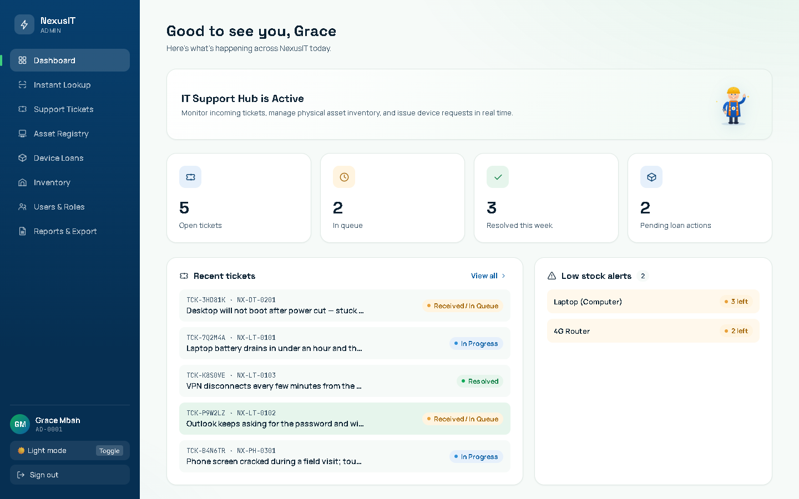
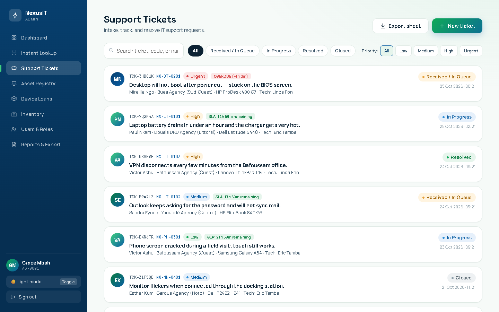
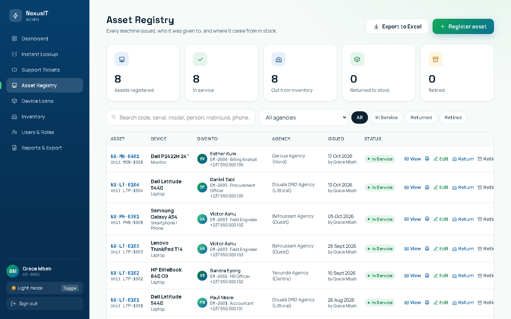
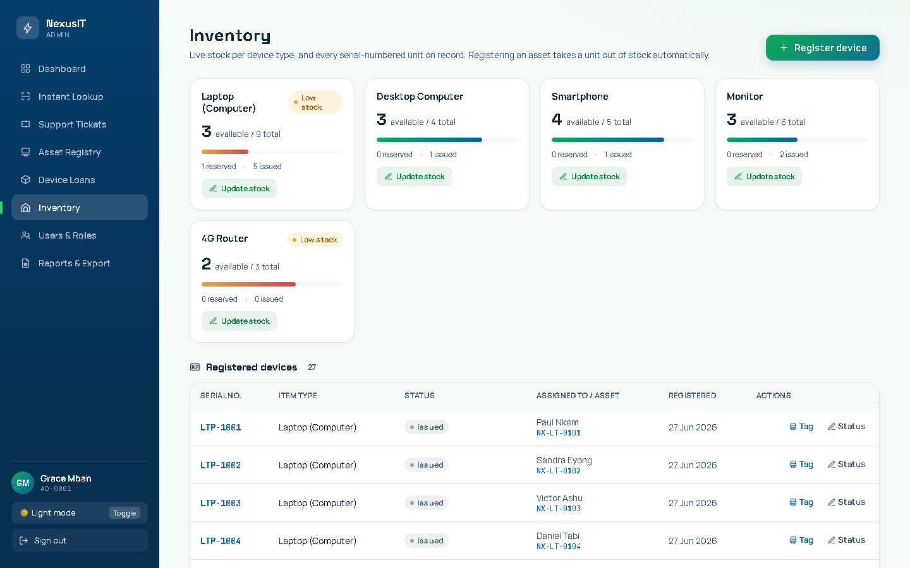
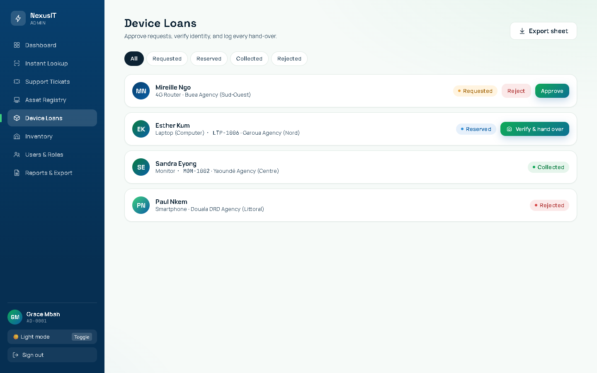
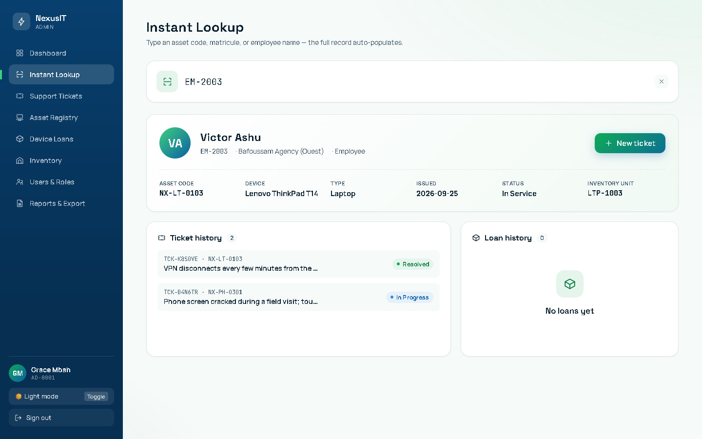
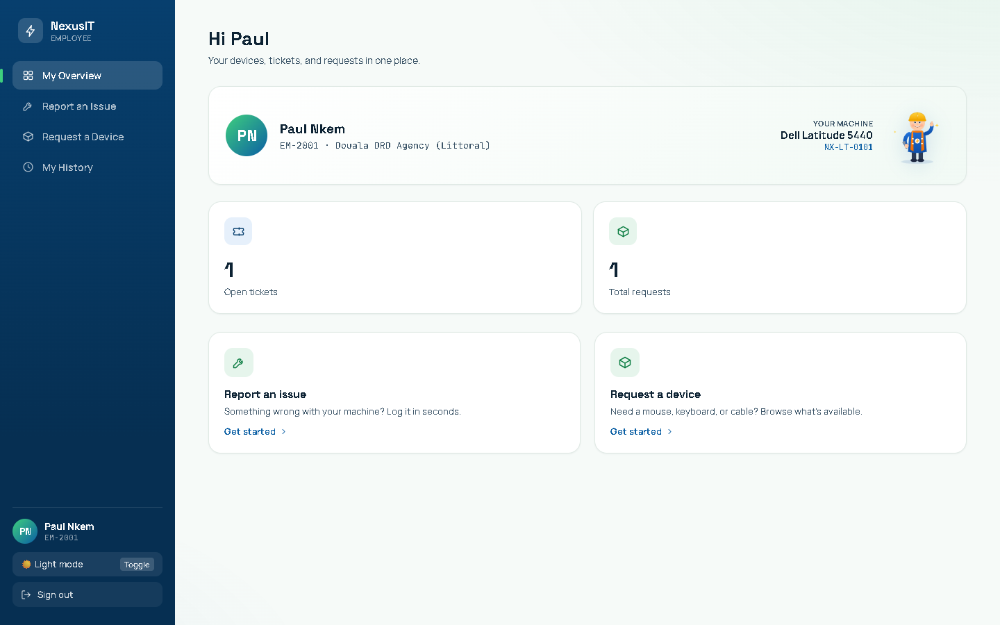
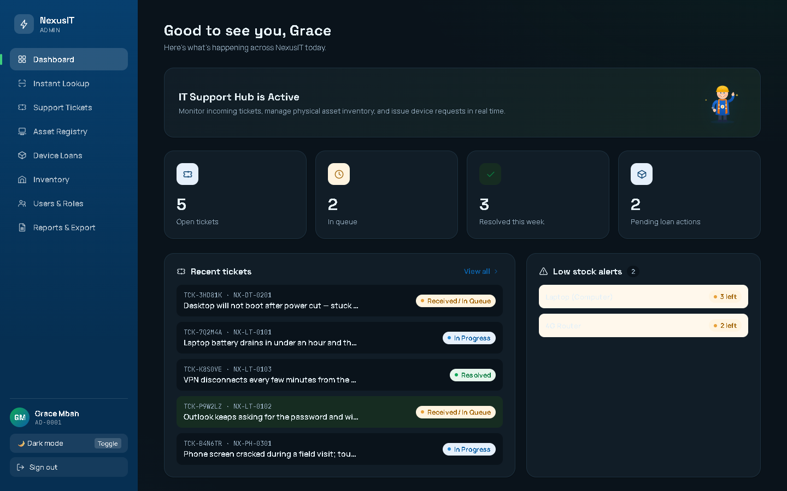
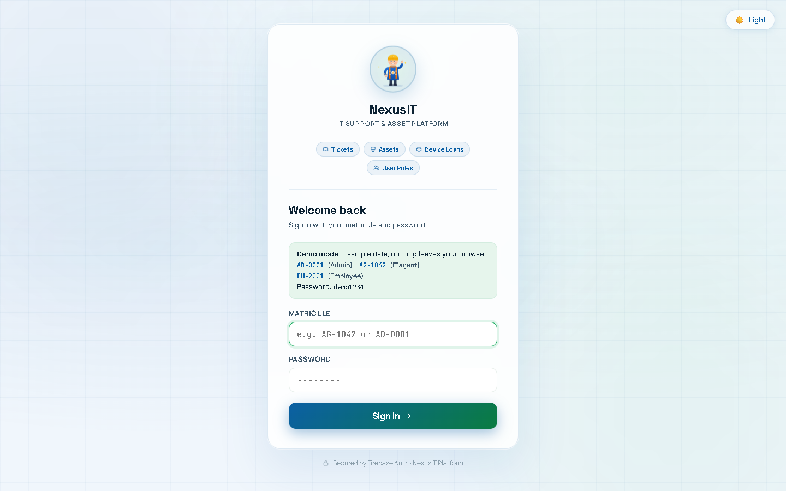

# NexusIT — IT Support & Asset Platform

An internal IT helpdesk for a multi-agency organisation: support tickets with SLA tracking, a full asset registry, serial-numbered inventory, device loans with identity-checked pickup, role-based access, and Excel exports for management.

Built with **React 18**, **Firebase Auth + Cloud Firestore** (live sync), **SheetJS** and **Vite**.



**Try it without any setup:** run the app in demo mode (below) and sign in as `AD-0001`, `AG-1042` or `EM-2001` with password `demo1234`. Demo mode runs on fictional sample data in the browser, with no Firebase project needed.

## Features

| | |
|---|---|
| **Support tickets** | Intake, priorities (Low → Urgent) with live SLA countdowns, technician assignment, status timeline (Queue → In Progress → Resolved → Closed). |
| **Asset registry** | Every machine issued: who holds it, where it came from in stock, condition, notes and a full assignment history. Return, re-issue, retire, and print asset tags. |
| **Inventory** | Stock per device category with low-stock alerts; each serial-numbered unit tracked through Available / Reserved / Issued / In Maintenance / Decommissioned. |
| **Device loans** | Employees request a device, agents approve and reserve a unit, and pickup is confirmed by verifying the employee's matricule. |
| **Instant lookup** | Type an asset code, matricule or name to get the person, their device and their ticket and loan history in one place. |
| **Roles** | Admin, IT agent and employee each get their own navigation and permissions. Employees get a self-service portal. |
| **Reports & export** | Per-agency summaries, average resolution time, and Excel exports of tickets, loans and the asset register (with formula-injection guarding). |
| **Polish** | Light/dark theme, responsive layout down to phone width, animated login mascot that follows your typing. |

Stock changes are done in **Firestore transactions**: issuing an asset and taking its unit out of inventory happen together or not at all, so two agents can't hand out the same laptop.

## Screenshots

| Support tickets | Asset registry |
|---|---|
|  |  |
| **Inventory** | **Device loans** |
|  |  |
| **Instant lookup** | **Employee portal** |
|  |  |
| **Dark mode** | **Sign in** |
|  |  |

## Getting started

Requires Node.js 18+.

```bash
npm install
npm run demo      # demo mode on sample data — no Firebase needed
```

### Connect your own Firebase project

1. Create a Firebase project and enable **Authentication → Email/Password** and **Cloud Firestore**.
2. Copy `.env.example` to `.env` and fill in your web app config.
3. `npm run dev`

Users sign in with a **matricule** (staff ID). The app maps it to a synthetic email (`<matricule>@nexusit.local`) for Firebase Auth, so no real email is needed. Create the first admin in the Firebase console (Auth user + a `users/{uid}` document with `role: "admin"`); after that, admins create accounts from **Users & Roles**.

Firestore collections: `users`, `assets`, `tickets`, `deviceCatalog`, `devices`, `loanRequests`. Lock them down with security rules that check the caller's `role` before deploying.

`functions/index.js` is an optional Cloud Function that moves account creation to the server.

```bash
npm run build     # production build in dist/
```

## Project structure

```
src/
├── App.jsx               # auth gate, live Firestore subscriptions, routing by role
├── main.jsx
├── styles.css            # design tokens, light/dark themes
├── components/           # UI primitives, layout shell, forms, icons, mascot
├── views/                # Dashboard, Tickets, Assets, Inventory, Loans, Users, Reports, Employee portal, Login
└── lib/
    ├── service.js        # picks the live or demo backend
    ├── firebaseService.js# Auth + Firestore wrapper (transactions for stock moves)
    ├── demoService.js    # in-memory backend with the same API
    ├── demoData.js       # fictional sample data
    ├── excel.js          # SheetJS exports
    ├── constants.js
    └── utils.js
```

## License

MIT
